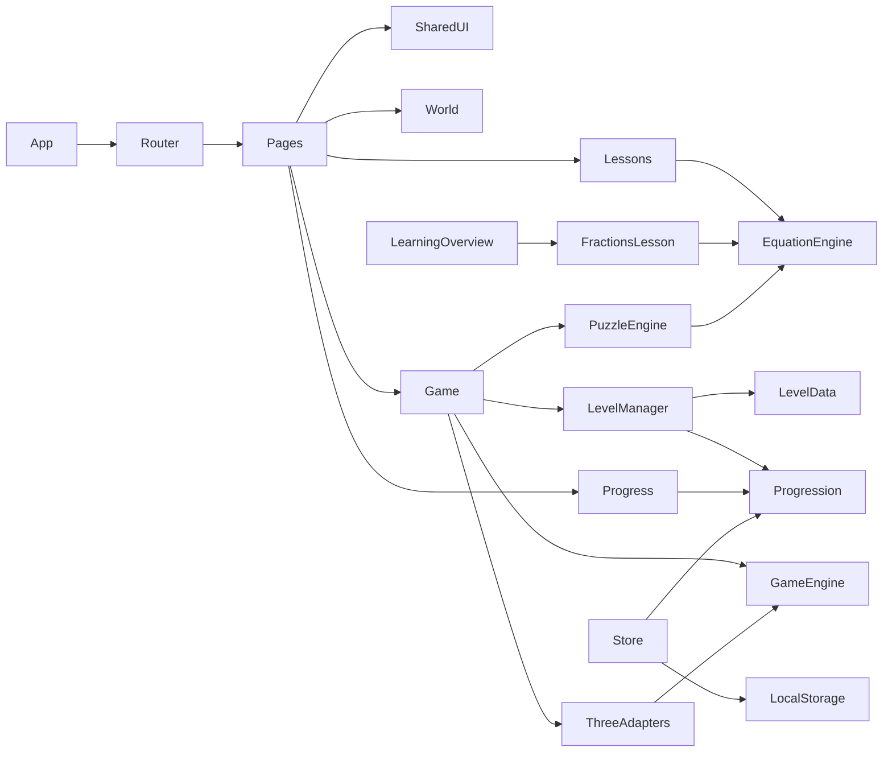

# Dependency map and proposed knowledge graph

**The Mermaid below is an architecture sketch, not proof of an extracted edge.** Actual source modules and Graphify output now exist; Phase 8 extraction produced 1260 nodes / 2086 edges / 140 communities. Use `graphify-out/graph.json` for extracted topology and the implemented-slice notes below for human-reviewed contracts.

| Source | Depends on | Contract / change impact |
|---|---|---|
| Router | Pages | route ID/path changes affect links + Playwright |
| Lessons (including independent FractionsLesson), PuzzleEngine | EquationEngine | math contract changes affect teaching and level gates |
| Game, ThreeAdapters | GameEngine | input/camera changes affect desktop/mobile and HUD |
| Game | LevelManager, PuzzleEngine | unlock/objective changes affect save and map |
| Progression/Store | Level IDs, LocalStorage | IDs/schema changes need migration and idempotence tests |
| Carousel | Router | destination changes affect landing navigation |

Later use Graphify `explain`, `affected` and `path` on **extracted** graph for component impact analysis; do not use this planned diagram as proof of implementation.

### Implemented Phase 6 slice

`Game/MechanicsLab → puzzle-engine → equation-engine`; `MechanicsLab → level-manager/workshop → equation-engine/generate`; `MechanicsLab → useWorkshopProgress → progression/workshop → progression/rewards + level-manager/workshop`. These modules are DOM/pure-state only, so the R3F renderer remains optional. The planned `Store → LocalStorage` and authored `LevelManager → LevelData`/`Progress → Progression` arrows above are **not implemented** for game progress; later phases own those contracts.

### Implemented Phase 7 stage flow

`Level/StageRunner → level-manager/stages + stage-session → puzzle-engine → equation-engine`; `Level/StageRunner → useLevelProgress → progression/levels → progression/rewards`; `World/Game → islandStatus/useLevelProgress`; `ExplorationScene` receives completed stage IDs only for decorative marker feedback (math remains DOM/pure). The workshop has its own independent reward store. Persistent stage save and Progress dashboard are **still planned for Phase 8**, not wired into these arrows.

### Implemented Phase 8 persistence (D30)

`Level/StageRunner → useLevelProgress → saved.ts → localStorage`; `Practice (fractions) → useFractionPractice → saved.ts → localStorage`; `MechanicsLab → useWorkshopProgress → saved.ts → localStorage`; `SiteFooter/Home/Game → usePreferences → localStorage`; `Progress → all four stores → clearAllSaved`. Persisted stage and practice answers are canonical string rationals. The Phase 6/7 "still planned" paragraphs above describe their historical boundaries; they are superseded by this slice. No new dependency.
