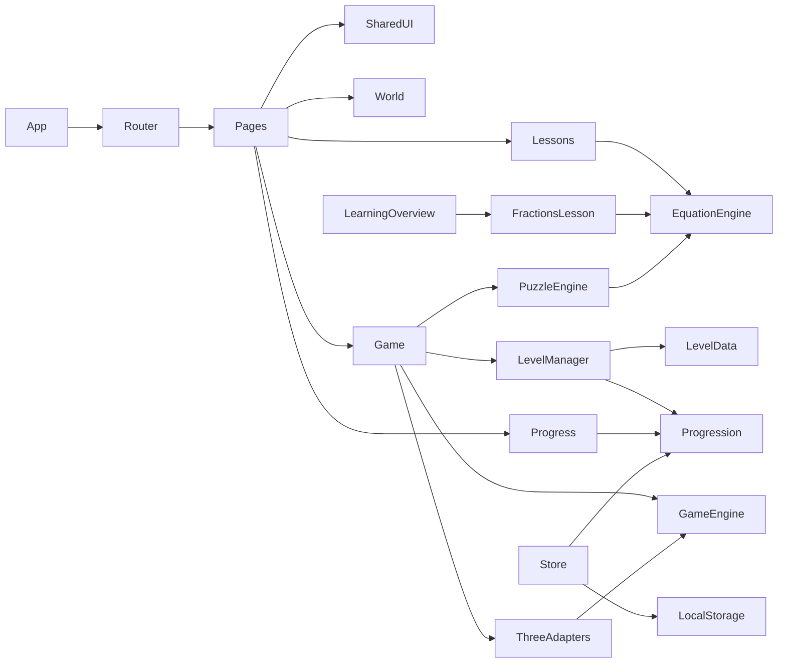

# Dependency map and proposed knowledge graph

**This is a design graph, not Graphify code extraction.** Codebase currently contains no `src/` modules; `graphify extract` cannot verify these edges yet. Compare with actual `graphify-out/graph.json` after first implementation and update this map.

| Source | Depends on | Contract / change impact |
|---|---|---|
| Router | Pages | route ID/path changes affect links + Playwright |
| Lessons (including independent FractionsLesson), PuzzleEngine | EquationEngine | math contract changes affect teaching and level gates |
| Game, ThreeAdapters | GameEngine | input/camera changes affect desktop/mobile and HUD |
| Game | LevelManager, PuzzleEngine | unlock/objective changes affect save and map |
| Progression/Store | Level IDs, LocalStorage | IDs/schema changes need migration and idempotence tests |
| Carousel | Router | destination changes affect landing navigation |

Later use Graphify `explain`, `affected` and `path` on **extracted** graph for component impact analysis; do not use this planned diagram as proof of implementation.
